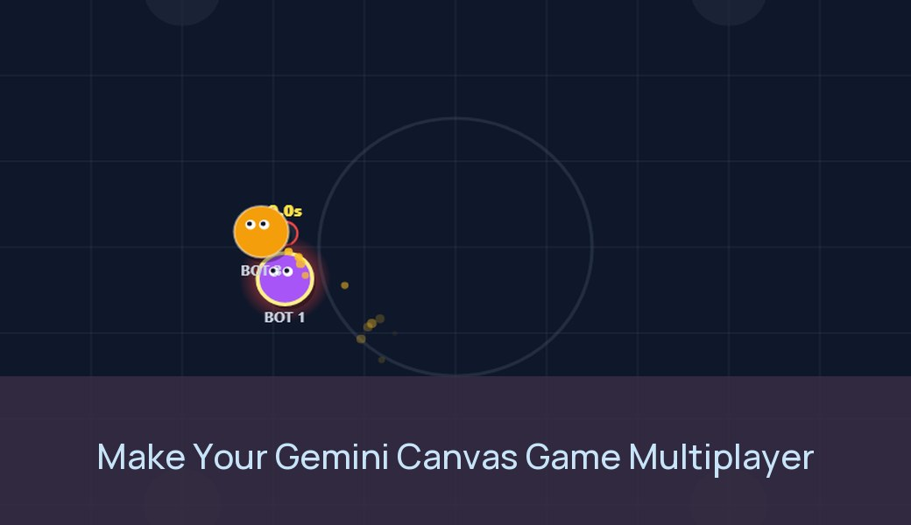

# How to make a multiplayer game with Gemini Canvas



A worked example you can follow step by step: **Gemini** writes a single-player browser game in
Canvas as one HTML file, then **Edgegap** takes it online with one authoritative server per match,
plus a matchmaker if you want a Find match button. Bomb Tag, a 4-runner game where touching a rival
passes the bomb and whoever holds it when the fuse runs out is out, is the game built here.

This repo is a recipe, not a live demo. Nothing in it runs on its own: you create your own Edgegap
app version (and matchmaker), play, and remove them when you're done. Each server stops itself when
its match ends, so you only pay while people play.

```
Gemini Canvas ──writes──> artifact/bomb-tag.html             (one HTML file, solo game vs bots,
                            │  rules between                   plays in the Canvas preview)
                            │  /* RULES:BEGIN */ ... /* RULES:END */
                            │
     tools/split-artifact.mjs ──copies the block──> client/rules.js (ES module, generated)
                                                       │
your page ──Find match──> Edgegap matchmaker ──starts──> one Node.js server per match
     <──────────── wss://<id>.pr.edgegap.net:<port> ──  runs rules.js at 60 Hz,
                                                        fills seats with bots,
                                                        stops itself after the match
```

Verified on Edgegap on 2026-11-20, both ways in: two browser tabs joined one server directly
(`?server=`) and played a full match, and the server stopped itself afterwards; then two headless
players and two browser tabs clicked **Find match**, were matched onto one server in about 15
seconds, and the server stopped itself 11 seconds after the match (and within about 20 seconds of
both tabs closing). Cost of a match: one 0.25 vCPU server for about a minute.

## What you need

- A Google account for Gemini (gemini.google.com). The game here was made on a free account with
  the model picker on Auto.
- An Edgegap account (app.edgegap.com). The free tier is enough: one matchmaker that stops about
  3 hours after each start, one server at a time.
- A GitHub repo. GitHub Actions builds the server image, so you don't need Docker on your computer.
- Node.js 22 to run the split script and the local tests.
- Optional but recommended: an AI coding agent with the Edgegap MCP server connected
  (`https://mcp.edgegap.dev`). Its `edgegap-chat-canvas` skill holds the prompt, the split script, the
  server templates, the matchmaker config and the tests used here.

## Values you will fill in

| Placeholder | Where it comes from | Where it goes |
|---|---|---|
| `<registry-project>` | Edgegap dashboard > Container Registry (looks like `edgegap-xxxxxxxx`) | GitHub variable `EDGEGAP_REGISTRY_PROJECT` |
| registry username / token | Container Registry > Credentials | GitHub secrets `EDGEGAP_REGISTRY_USERNAME`, `EDGEGAP_REGISTRY_TOKEN` (never in the code) |
| `<image-tag>` | The build summary of the Server image workflow (`YYYYMMDD-HHMM`) | App version tag and name, `matchmaker/bomb-tag.json` |
| `<server-url>` | Deployments > your deployment: `wss://<fqdn>:<external port>` | `?server=` on the page URL (step 6) |
| `<page-origin>` | Where you serve `client/` (`http://localhost:8080`, `https://<org>.github.io`...) | `allowed_cors_origins` in `matchmaker/bomb-tag.json` |
| `<matchmaker-url>`, `<matchmaker-token>` | Matchmaker page > API URL and Auth Token | `client/config.js` |

The matchmaker Auth Token is a client token: it can only ask for matches and is made to ship in
game pages. Never put your Edgegap API token in the page, the repo or the image.

## Step 1: Ask Gemini for a game that can go online

In Gemini, click **+**, pick **Canvas**, and send the prompt. Canvas writes the game as one HTML
file and runs it in a preview with **Code** and **Preview** tabs. The server needs the rules on
their own, so ask Gemini to keep every rule between two exact marker lines, with nothing from the
browser inside. The file stays one file that plays in Canvas, and a script copies the block out
for the server (step 2).

The prompt used for Bomb Tag, verbatim, in a new chat with Canvas selected:

> Build a small browser game as a single HTML file called "Bomb Tag" (plain Canvas 2D, no
> frameworks, no external libraries) and show it in Canvas so I can play it in the preview.
> Gameplay: 4 round runners in a square arena (800x800 units) move with WASD/arrow keys with drift
> (velocity + friction). One random runner holds a bomb with a 12-second fuse. Touching another
> runner passes the bomb to them (the new holder can't pass it back for 0.6 s). When the fuse runs
> out, the holder explodes and is out; the bomb goes to a random remaining runner with a fresh
> fuse. Last runner standing wins, then a results screen and restart. The human plays against 3
> simple bots. VERY IMPORTANT architecture: put ALL game rules in one block between the exact
> lines /* RULES:BEGIN */ and /* RULES:END */, with NO window, document, canvas, audio,
> requestAnimationFrame or timers inside, and no export keyword. The world is plain data
> (objects, arrays, numbers, strings; no classes or Maps). The block defines createWorld() that
> returns a world with no players, addPlayer(world, id, name, isBot) that places each new player
> at its own free start spot (up to 4 players, any ids), removePlayer(world, id), setInput(world,
> id, {up,down,left,right}) that works for every player, step(world, dt) that moves bot players
> itself with botInput() and returns an array of events ({type:'pass', from, to}, {type:'boom',
> id} and {type:'win', winner}), and botInput(world, id) using only positions and who holds the
> bomb. Everything else (rendering, keyboard input, calling step() at 60 Hz) stays outside the
> block.

For your own game, change the gameplay sentences and keep the architecture part as it is.

Why the prompt is shaped this way:

| Prompt detail | Why it matters online |
|---|---|
| Rules between `/* RULES:BEGIN */` and `/* RULES:END */`, no `window`/`document`/canvas/timers, no `export` | The file still plays in Canvas, and the block runs unchanged in Node.js on the server. No port, no drift between solo and online. |
| The world is plain data | The server sends its world over the network as JSON (about 1 KB here), and the page draws it with Gemini's own `render()`. |
| `createWorld()` with no players, a start spot per `addPlayer()`, `setInput()` for every player, bots moved inside `step()` | The server seats its own players with its own ids and fills the empty seats with bots. Earlier chat games got these wrong; asking up front means no fix prompt. |
| `step(world, dt)` returns events | The server forwards passes, explosions and the win for effects, and ends the match on the win. |
| Bumping, chasing, running away | The game still feels right with 50 to 100 ms of network delay. Pick slippery movement, pushing, slow shots or turn-based play; avoid precise platforming, rhythm or instant-hit aiming. |

**Play it before you save it.** In the Canvas preview, check that the bots move and the fuse counts
down. Gemini's Bomb Tag was right on the first answer; no follow-up prompt was needed.

**Get the file out.** In Canvas, **Export > Download code** saves the HTML file. Save it unchanged
as `artifact/bomb-tag.html`. That commit is tag `before` here. `PROMPTS.md` has the prompt.

**Done when:** the file plays solo with moving bots, and it contains both marker lines.

## Step 2: Split out the rules

```
node tools/split-artifact.mjs artifact/bomb-tag.html --page
```

- Copies the block into `client/rules.js`, adds `export { createWorld, addPlayer, ... }` for every
  top-level name, and marks the file as generated.
- Refuses a block that uses `window`, `document`, `canvas`, timers, `console`, `import`/`export` and
  other browser-only or module code, with the line, and refuses one that lacks any of the six
  functions.
- `--page` (first time only) writes `client/index.html`: the artifact with the block removed and its
  `<script>` turned into a module that imports the rules. This is the page you make online in step 3.

When you change the game later in Gemini, save the new file over `artifact/bomb-tag.html`
and run `npm run split`. CI runs `npm run check:rules`, which fails when `client/rules.js` no longer
matches the artifact, so the server can never run old rules.

**Done when:** `npm run check:rules` prints `client/rules.js matches artifact/bomb-tag.html`.

## Step 3: Add online play

The prompt for an AI coding agent with the Edgegap MCP:

> Make this Gemini Canvas game online multiplayer on Edgegap. Use the Edgegap MCP and its
> edgegap-chat-canvas skill. Keep the solo mode, add a Find match button, 2 to 4 players per match,
> bots fill empty seats. Ask me before you create anything in my Edgegap account.

What gets added (all of it is in this repo, ready to copy):

| File | What it does |
|---|---|
| `tools/split-artifact.mjs` | Step 2: the rules block becomes `client/rules.js`; `--check` keeps them in sync. |
| `server/main.js`, `room.js`, `edgegap.js`, `util.js` | Edgegap templates: connections, phases (waiting, countdown, playing, over), bots, the self-stop when the match ends. |
| `server/game.js` | About 85 lines that wrap `client/rules.js`: take the four buttons from players, seat players in random order (Gemini's `addPlayer()` gives the bomb to the first one), run `step()` (it moves the bots), rank players by when they went out, send the world 20 times a second. The only server file you adapt to your game. |
| `client/online.js`, `client/net.js` | Find match through the Edgegap JS SDK, then the WebSocket to the match server, with retries while the server boots. |
| `client/index.html` | Gemini's page, plus about 80 lines: Find match / Local server / Cancel buttons and a status line in the header, drawing the server's world with Gemini's `render()`, easing runners between updates, waiting and countdown on Gemini's overlay, closing the socket when the tab closes. Restart still plays solo. |
| `client/config.js` | `<matchmaker-url>` and `<matchmaker-token>`, empty until step 7. |
| `server/Dockerfile` | Node 22 image with `server/` and `client/rules.js`. |
| `tests/local-match.mjs` | Two headless players play a full match against a local server. Runs in CI on every build. |
| `tests/e2e.mjs` | The same through the real matchmaker and a real Edgegap server, then checks the server stopped itself. |

The server never trusts the browser: it only accepts four booleans, and decides movement, rams and
passes and explosions itself. The human's id was a constant (`'p1'`) and the colors were keyed by the
solo ids: online the id is the server's player id, and colors follow each runner's start corner.
Gemini draws names on the canvas, so there was no HTML to escape.

**Done when:** `npm install && npm run test:local` prints `PASS`, and two tabs on the local page
(**Local server :7777**) see the same match.

## Step 4: Build the server image with GitHub Actions

`.github/workflows/server-image.yml` builds the server on every push to `main` (and on demand),
checks the rules match the artifact, runs the local match test, and pushes the image to the
Edgegap Container Registry as `registry.edgegap.com/<registry-project>/bomb-tag:<image-tag>`.

One-time setup in the GitHub repo (Settings > Secrets and variables > Actions):

1. Variable `EDGEGAP_REGISTRY_PROJECT` = `<registry-project>`.
2. Secrets `EDGEGAP_REGISTRY_USERNAME` and `EDGEGAP_REGISTRY_TOKEN` from the Credentials box. Don't
   click Regenerate Token if other projects already push to that registry.

> **Pitfall:** with its default settings, `docker/build-push-action` adds provenance attestations,
> which wrap the image in a multi-manifest index. Edgegap then fails with "Unable to pull image from
> registry". Keep `provenance: false` and `sbom: false` in the workflow, as this repo does.

**Done when:** the workflow's summary shows `Pushed registry.edgegap.com/...:<image-tag>`.

## Step 5: Create the app version in the Edgegap dashboard

Applications > Create application (`bomb-tag`), then the version form:

| Setting | Value | Why |
|---|---|---|
| Version name | `<image-tag>` | Easy to match builds to versions. |
| vCPU | 0.25 (512 MB RAM) | Plenty for a 4-player Node.js match. |
| Registry | Edgegap (registry.edgegap.com), repository `<registry-project>/bomb-tag`, tag `<image-tag>` | The dashboard fills the pull credentials. |
| Max duration | 30 minutes | A backstop: the server normally stops itself much earlier. |
| Restart policy | Never | A crashed match should end, not restart half-played. |
| Port | 7777, protocol **WS**, name `gameport`, **TLS Upgrade on** | Pages on https can only open `wss://`. Edgegap adds TLS in front, so the server stays plain `ws`. |
| Env `EMPTY_TIMEOUT_S` | 15 | Stop 15 s after the last player leaves. |
| Env `FIRST_JOIN_TIMEOUT_S` | 60 | Stop if nobody connects. |
| Env `RESULTS_SECONDS` | 8 | Results screen length before the server stops. |

To ship a new server build later, change the tag on the version and save. Running matches are not
affected.

**Done when:** the version shows the port `7777 WS gameport` with TLS Upgrade `true` and the three
env vars.

## Step 6: Play online without a matchmaker

The quickest way online, and enough for playing with friends: start one server and share its
address.

1. Deployments > Create deployment, pick `bomb-tag` and `<image-tag>`, and place it near the
   players (or let your coding agent call `edgegap_deploy` through the Edgegap MCP).
2. When it is Ready, copy the `gameport` address: `wss://<fqdn>:<external port>` is `<server-url>`.
3. Everyone opens `<page>?server=<server-url>`. The page joins that server straight away. Bots fill
   the empty seats, and the match starts 15 seconds after the first player joins.

**Done when:** two windows on that URL play the same match, and the deployment disappears from the
list by itself once the match is over and everyone has left.

## Step 7: Add the matchmaker (optional)

For a **Find match** button that groups strangers and starts a server for each match:

1. In `matchmaker/bomb-tag.json`, set `application.version` to `<image-tag>` and list every
   `<page-origin>` in `allowed_cors_origins` (scheme + host + port; the file starts with
   `http://localhost:8080`).
2. Matchmakers > Create Matchmaker, upload the file, **Create and Start**. The dashboard may warn
   that the image "is not cached" or "not valid" when it can't check a private registry: continue,
   the end-to-end test proves it.
3. Copy the **API URL** and **Auth Token** into `client/config.js` (or a git-ignored
   `client/config.local.js` with the same shape, or `?mm=<url>&token=<token>` on the page URL).

The profile `bomb-tag` matches 2 to 4 players. After 20 seconds in the queue, a lone player gets a
match on their own and bots fill the other seats, so nobody waits forever.

**Done when:** the matchmaker shows ONLINE and **Find match** on the page says "Searching for
players...".

## Step 8: Prove it end to end

1. Serve the page: `npm run client`, then http://localhost:8080 (or publish `client/` with
   `.github/workflows/pages.yml`, and add `https://<org>.github.io` to the CORS list).
2. Actions > **Matchmaker e2e** > Run workflow (it reads `client/config.js`). Two headless players
   queue, land on the same server, play a match, and the test checks that the server stopped
   itself. The passing run for this example:

   ```
   e2e-1: SEARCHING after 3s
   e2e-1: MATCH_FOUND after 13s
   e2e-1: HOST_ASSIGNED after 15s
   server: wss://<id>.pr.edgegap.net:<port>
   result: Zed (bot) survives!; scores: Zed (bot) 3, e2e-1 2, Rusty (bot) 1, e2e-2 0
   deployment stopped itself 11s after the match
   PASS
   ```

3. Open the page in two browser windows and click **Find match** in both within 20 seconds. Both
   land in the same match with two bots, on a server near you. `?autoplay=1` on the URL starts
   Find match on page load.
4. In the dashboard's Deployments list, nothing stays running after the match.

**Done when:** the e2e workflow prints `PASS` and the two windows played one match together.

## Step 9: Clean up

Nothing here should run non-stop:

- Each match server stops itself when the match ends (or 15 s after everyone leaves, or 60 s if
  nobody joins; 30 minutes at most). Stop a direct deployment from step 6 yourself if nobody joined
  it.
- **Stop or delete the matchmaker** when you're done testing. On the free tier it stops by itself
  about 3 hours after each start; Start or Quick Restart brings it back for the next session.
- If you published the page, players only get "Could not find a match" while the matchmaker is
  off; **Play vs bots** keeps working. Unpublish it (Settings > Pages) if you don't want it up.
- The app version, registry images and GitHub secrets cost nothing while idle.

## Troubleshooting

| Symptom | Fix |
|---|---|
| `split-artifact: markers not found` | The file lost the marker lines. Ask Gemini to put back the exact lines `/* RULES:BEGIN */` and `/* RULES:END */`. |
| `split-artifact: the rules block uses browser-only or module code` | It names the line. Ask Gemini to move that code outside the block (drawing, sounds and timers belong to the page). |
| CI fails at "client/rules.js matches the artifact's rules block" | You saved a new file without running `npm run split`. Run it and commit `client/rules.js`. |
| Deployment log: "Unable to pull image from registry" | `provenance: false` / `sbom: false` in the build, check the registry secrets, then put the new tag on the version. |
| Find match fails immediately in the browser | The page's origin is missing from `allowed_cors_origins`, the matchmaker is stopped, or `client/config.js` has the wrong URL or token. |
| "Server starting, connecting (n/10)" | Normal for a few seconds after a server is assigned. If it never connects, check the port is WS with TLS Upgrade on. |
| Matched but the page shows nobody else | Both players must queue within 20 seconds of each other, or each gets their own match with bots. |
| Servers keep running | Check the env vars in step 5 and that restart policy is Never. The 30-minute max duration stops them anyway. |

## Make your own

1. Run the step 1 prompt with your own game idea, keeping the architecture part. Play it, then save
   the file as `artifact/<game>.html`.
2. Copy `tools/`, `server/`, `client/online.js`, `client/net.js`, `client/config.js`, `tests/`,
   `matchmaker/` and `.github/workflows/` from this repo, run the split with `--page`, then adapt
   `server/game.js` to your rules (mostly the snapshot fields), `playLikeABot()` in
   `tests/headless-player.mjs`, and the online part of `client/index.html`.
3. Follow steps 4 to 9 with your own placeholders.

## Repo layout

- `artifact/bomb-tag.html`: Gemini's file, unchanged. The source of the rules.
- `PROMPTS.md`: the prompt, and what Gemini did.
- `tools/split-artifact.mjs`: copies the rules block into `client/rules.js`, checks it, keeps it in sync.
- `client/rules.js`: generated from the artifact. Imported by the page and by the server.
- `client/index.html`: Gemini's page with online play added; `client/online.js`, `net.js`, `config.js`: Edgegap JS SDK matchmaking, the WebSocket client, the matchmaker settings.
- `server/`: room, phases, bots, self-stop (Edgegap templates); `game.js` wraps the rules.
- `matchmaker/bomb-tag.json`: matchmaker config to upload in the Edgegap dashboard.
- `tests/`: local match test and matchmaker end-to-end test.
- `.github/workflows/`: server image build, matchmaker e2e, optional GitHub Pages.

## Run locally

```
npm install
npm run server        # ws://localhost:7777
npm run client        # http://localhost:8080 -> "Local server :7777" (open two tabs)
npm run test:local    # rules in sync + two headless players play a full match
```

Credits: game design, rules and renderer by Gemini (Gemini Canvas); Edgegap integration from the
Edgegap MCP skills (`edgegap-chat-canvas`, `edgegap-threejs`).

License: MIT (see `LICENSE`).
